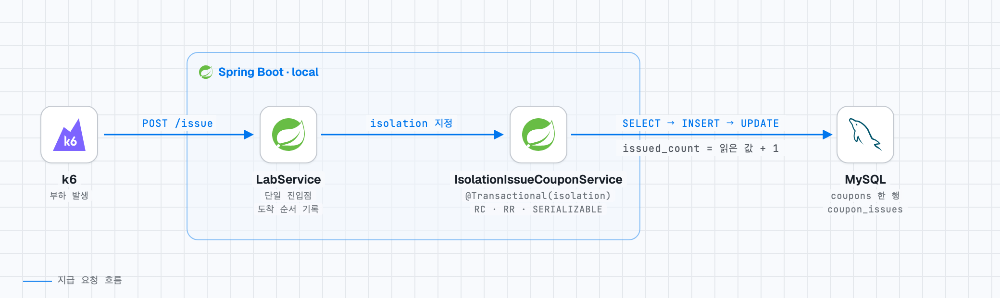
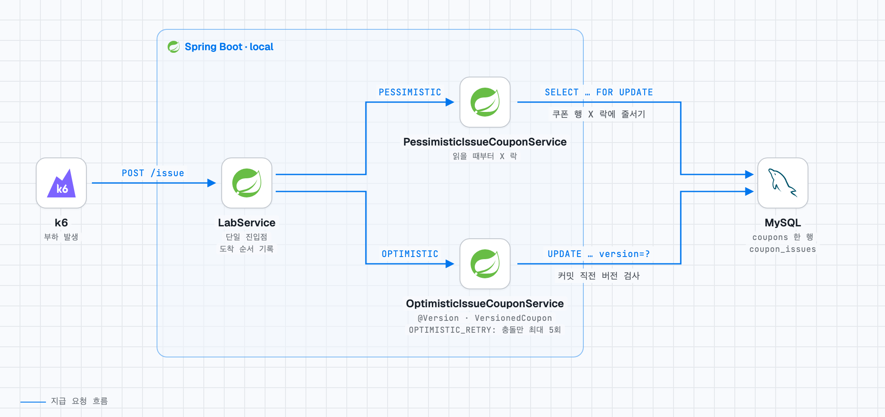
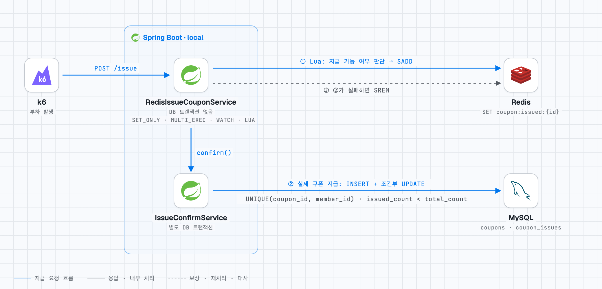
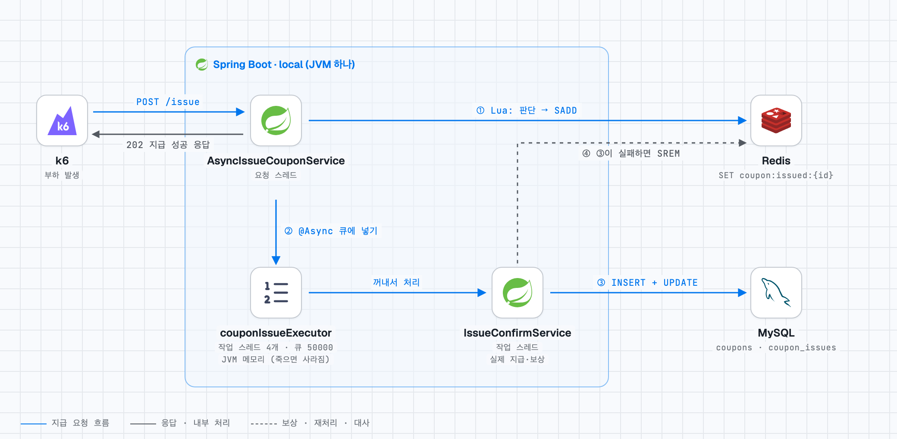
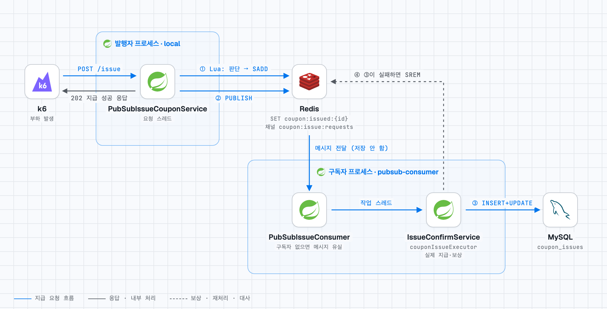
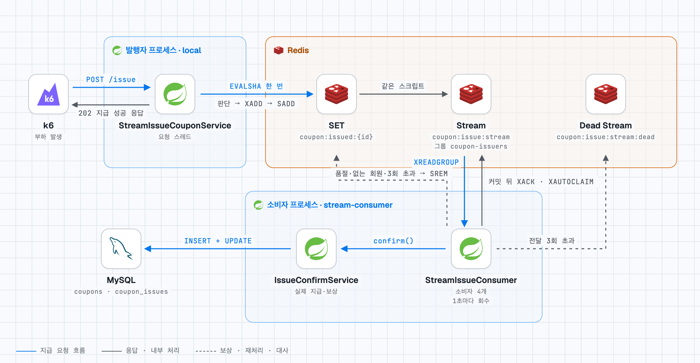
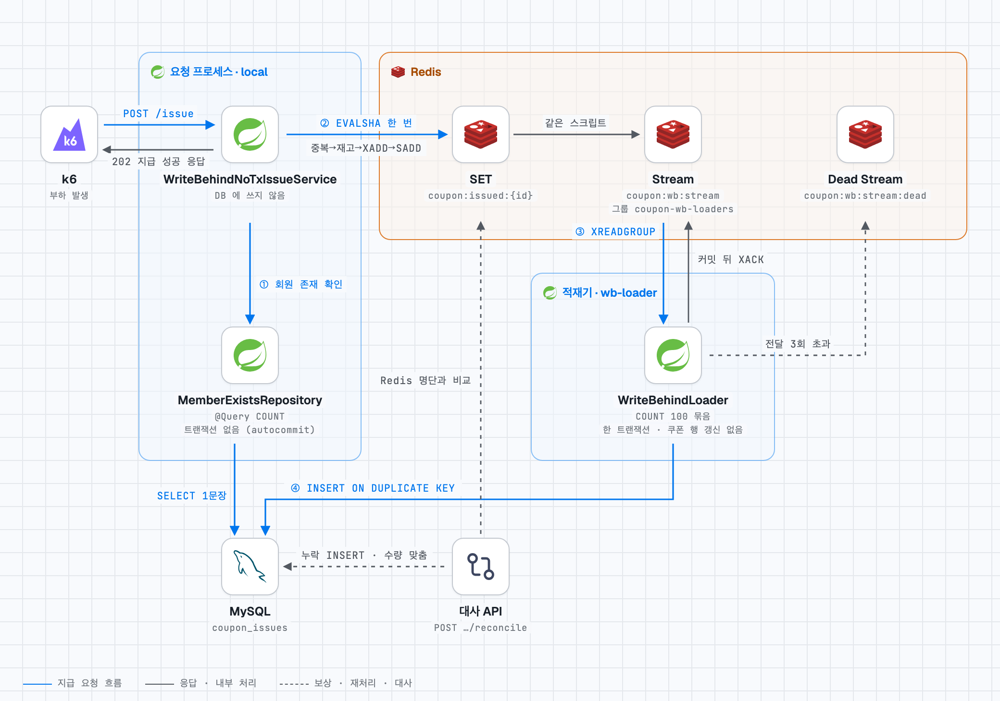

# 선착순 쿠폰 지급 시스템

고동시성 환경에서 선착순 쿠폰을 정확하게 지급하는 토이 프로젝트.

**핵심 불변식**
- 지급 수량을 절대 초과하지 않는다
- 동일 사용자에게 1장만 지급한다

## 학습 단계

동시성 제어와 비동기 처리를 한 단계씩 구현하고 직접 실행해 확인한다. 계획, 실험 API(`/lab`, `local` 프로필 전용), 단계별 결과는 [docs/learning](docs/learning/README.md) 에 있다.

- [1단계: 명시적 락 없이 격리 수준 비교](docs/learning/01-isolation-level.md)
- [2단계: 비관적 락과 낙관적 락](docs/learning/02-optimistic-pessimistic.md)
- [3단계: Redis 지급 처리 — SET 명령만 / MULTI/EXEC / WATCH / Lua](docs/learning/03-redis-transaction-lua.md)
- [4단계: Spring @Async](docs/learning/04-async.md)
- [5단계: Redis Pub/Sub](docs/learning/05-pubsub.md)
- [6단계: Redis Streams](docs/learning/06-streams.md)
- [부하 테스트: 일정한 속도로 보낼 때 (Mac)](docs/learning/07-load-test.md)
- [AWS(EC2)에서 잰 쿠폰 1장 실제 지급 한계](docs/learning/08-load-test-ec2.md)
- [9단계: write-behind — Redis 를 기준으로, DB 는 나중에](docs/learning/09-write-behind.md)
- [10단계: 회원 확인에서 쓸데없는 트랜잭션 설정 문장 없애기](docs/learning/10-no-tx-member-check.md)
- [선착순 쿠폰 이벤트 오픈 시나리오 (10단계 방식)](docs/learning/11-event-load-test.md)

## 기술 스택

| 분류 | 기술 |
|---|---|
| Language | Java 17 |
| Framework | Spring Boot 3.4.1, Spring Data JPA, Spring Data Redis |
| Database | MySQL 8.0.36 |
| Cache | Redis 7.2 |
| Test | JUnit 5, k6 |

## 실행 방법

기본 설정은 `src/main/resources/application.yml`(git 미추적) 에 있다. 기본 프로필은 `local` 이다.

- MySQL: `localhost:3306`, DB `CouponToyProject`
- Redis: `localhost:6379`
- 테스트: `CouponToyProject_test` DB(create-drop), Redis db 1

```bash
docker compose up -d mysql redis
./gradlew bootRun
./gradlew test
```

`DELETE /lab/data` 는 연결된 DB 의 쿠폰·지급·회원 테이블을 TRUNCATE 하고 Redis `coupon:*` 키를 지운다. 기존 데이터를 남기려면 별도 스키마로 띄운다.

```bash
SPRING_DATASOURCE_URL='jdbc:mysql://localhost:3306/CouponToyProject_lab?createDatabaseIfNotExist=true' \
SPRING_DATA_REDIS_DATABASE=2 ./gradlew bootRun
```

## API (`local` 프로필 전용, 인증 없음)

| Method | Path | Body | 설명 |
|---|---|---|---|
| POST | `/lab/members` | `{"count": 1000}` | 실험용 회원 일괄 생성 |
| POST | `/lab/coupons` | `{"name": "s1", "totalCount": 100}` | 실험용 쿠폰 생성 |
| POST | `/lab/coupons/{couponId}/issue` | `{"memberId": 1, "method": "SERIALIZABLE"}` | 방식 선택 지급: `READ_COMMITTED`, `REPEATABLE_READ`, `SERIALIZABLE`, `PESSIMISTIC`, `OPTIMISTIC`, `OPTIMISTIC_RETRY`, `REDIS_SET_ONLY`, `REDIS_MULTI_EXEC`, `REDIS_WATCH`, `REDIS_LUA`, `REDIS_ASYNC`·`REDIS_PUBSUB`·`REDIS_STREAM`·`REDIS_STREAM_ATOMIC`·`REDIS_WRITE_BEHIND`·`REDIS_WRITE_BEHIND_NO_TX`(202 지급 성공 응답). 격리 수준 방식은 `duplicateCheck: false` 가능 |
| GET | `/lab/coupons/{couponId}/result` | | 지급 결과, 수량, 검증 기준, 순서, 지연 |
| POST | `/lab/write-behind/coupons/{couponId}/reconcile` | | 9단계 대사: Redis 에만 있는 회원 INSERT, `issued_count` 를 행 수로 맞춤, DB 에만 있는 회원·재고 초과 보고 |
| DELETE | `/lab/data` | | 실험 데이터 초기화 |

모든 응답은 아래 형태로 반환된다. 품절·중복은 409, 데드락·락 대기 초과·낙관적 락 버전 충돌·비동기 큐 포화는 503, 없는 회원·쿠폰·경로는 404, 잘못된 입력은 400.

```json
{ "success": true,  "response": { }, "error": null }
{ "success": false, "response": null, "error": { "message": "...", "status": 409 } }
```

## 단계별 플로우

단계마다 한 가지만 바꿔 가며 구현했다. 그림의 실선 파란 화살표가 지급 요청 흐름이고, 점선은 보상·재처리·대사다. 7·8·11번 문서는 플로우가 아니라 부하 테스트라 [EC2 측정 결과](#ec2-측정-결과)에 정리했다.

### 1단계: 격리 수준 비교

<picture>
  <source media="(prefers-color-scheme: dark)" srcset="docs/images/flow/stage1-isolation-dark.png">
  
</picture>

같은 로직을 격리 수준만 바꿔 실행했다. READ COMMITTED·REPEATABLE READ 는 갱신 손실과 초과 지급이 났고, SERIALIZABLE 은 초과 지급은 막았지만 데드락으로 재고 1000 에 103장만 지급했다(재시도 없음). [문서](docs/learning/01-isolation-level.md)

### 2단계: 비관적 락과 낙관적 락

<picture>
  <source media="(prefers-color-scheme: dark)" srcset="docs/images/flow/stage2-lock-dark.png">
  
</picture>

요청 50건, 재고 50 에서 비관적 락은 쿠폰 행 X 락에 줄을 세워 50장을 지급했다. 낙관적 락은 6장, 충돌만 최대 5회 재시도해도 26~34장에 그쳤다. [문서](docs/learning/02-optimistic-pessimistic.md)

### 3단계: Redis 지급 처리 (REDIS_SET_ONLY · REDIS_MULTI_EXEC · REDIS_WATCH · REDIS_LUA)

<picture>
  <source media="(prefers-color-scheme: dark)" srcset="docs/images/flow/stage3-redis-dark.png">
  
</picture>

SET 명령만 쓰면 명령 사이에 다른 요청이 끼어들어 Redis 지급 처리가 재고를 넘었다. WATCH 와 Lua 는 판단과 지급 처리를 한 번에 해서 지켰고, 4단계부터 Lua 를 기준으로 쓴다. DB 의 조건부 UPDATE 와 UNIQUE 가 마지막 방어선이다. [문서](docs/learning/03-redis-transaction-lua.md)

<details>
<summary>상세 플로우</summary>

```
RedisIssueCouponService.issue(memberId, couponId, method)   ← DB 트랜잭션 없음

  [0] GET coupon:total:{couponId}                총수량 (없으면 DB 에서 읽어 다시 넣음)
  [1] Redis 지급 처리 (CouponIssuedRedisRepository)  "이미 지급 처리됨 → 재고 소진 → 지급 처리" 순서, 원자성만 방식별로 다름
        REDIS_SET_ONLY    SISMEMBER, SCARD, SADD 를 따로 보냄 (명령 사이에 다른 요청이 끼어든다)
        REDIS_MULTI_EXEC  MULTI SCARD SADD EXEC → Java 판단 → 재고 초과면 SREM
        REDIS_WATCH       WATCH → 읽기 → MULTI SADD EXEC (키가 바뀌었으면 다시, 최대 10회)
        REDIS_LUA         EVALSHA 한 번 (4~6단계 공통 기준)
  [2] IssueConfirmService.confirm() — 실제 쿠폰 지급, 별도 DB 트랜잭션
        INSERT coupon_issues                     UNIQUE(coupon_id, member_id)
        UPDATE coupons SET issued_count = issued_count + 1
         WHERE coupon_id = ? AND issued_count < total_count   0건이면 SOLD_OUT_AT_DB
  [3] [2] 실패 시 SREM 으로 Redis 지급 처리를 취소한다. UNIQUE 위반(이미 지급된 회원)은 취소하지 않는다
```

</details>

### 4단계: @Async (REDIS_ASYNC)

<picture>
  <source media="(prefers-color-scheme: dark)" srcset="docs/images/flow/stage4-async-dark.png">
  
</picture>

지급 성공 응답(202)은 실제 지급 완료가 아니다. 작업이 JVM 메모리 큐에 있어서, 강제 종료하면 큐의 작업이 사라지고 Redis 지급 처리만 남았다(865~897건). [문서](docs/learning/04-async.md)

<details>
<summary>상세 플로우</summary>

```
AsyncIssueCouponService.issue(memberId, couponId)        ← 요청 스레드
  [1] RedisIssueCouponService.reserve(LUA)                3단계와 같은 Redis 지급 처리
  [2] RedisIssueCouponService.confirmLater()  @Async     couponIssueExecutor 큐에 넣고 바로 반환 → HTTP 202 (지급 성공 응답)
        큐가 가득 차면 TaskRejectedException → SREM, HTTP 503
작업 스레드 (스레드 풀 couponIssueExecutor: 기본 4개, 큐 50000, JVM 메모리)
  [3] IssueConfirmService.confirm(), 실패 시 SREM          3단계와 같은 실제 지급·보상
결과 API: asyncResults(지급 성공 응답을 보낸 요청의 실제 지급 결과), pending(지급 성공 응답을 보냈지만 실제 지급 결과가 아직 없는 요청)
```

</details>

### 5단계: Redis Pub/Sub (REDIS_PUBSUB)

<picture>
  <source media="(prefers-color-scheme: dark)" srcset="docs/images/flow/stage5-pubsub-dark.png">
  
</picture>

발행자와 구독자를 프로세스로 나눴지만 메시지를 저장하지 않는다. 구독자가 없으면 메시지가 사라지고, 받은 뒤 구독자를 강제 종료하면 구독자 큐의 메시지가 사라졌다(952~967건). [문서](docs/learning/05-pubsub.md)

<details>
<summary>상세 플로우</summary>

```
발행자 프로세스 (local)        PubSubIssueCouponService.issue()      ← 요청 스레드
  [1] RedisIssueCouponService.reserve(LUA)                          3단계와 같은 Redis 지급 처리
  [2] PUBLISH coupon:issue:requests "memberId:couponId" → HTTP 202 (PUBLISHED)
        돌려받는 "받은 구독자 수" 는 완료가 아니다. 구독자가 없으면 0 이고 메시지는 사라진다
구독자 프로세스 (pubsub-consumer)   PubSubIssueConsumer → 작업 스레드(couponIssueExecutor)
  [3] IssueConfirmService.confirm(), 실패 시 SREM                  3단계와 같은 실제 지급·보상
결과 API: publishReceivers(받은 구독자 수별 요청 수), redisOnlyMembers(Redis 지급 처리만 있고 실제 지급되지 않은 회원)
```

</details>

### 6단계: Redis Streams (REDIS_STREAM · REDIS_STREAM_ATOMIC)

<picture>
  <source media="(prefers-color-scheme: dark)" srcset="docs/images/flow/stage6-stream-dark.png">
  
</picture>

DB 커밋 뒤에만 XACK 한다. 소비자가 받은 뒤 강제 종료돼도 pending 에 남아 회수되어 유실이 0건이었고, 재처리는 UNIQUE 위반으로 끝나 `issued_count` 가 다시 늘지 않는다. [문서](docs/learning/06-streams.md)

<details>
<summary>상세 플로우</summary>

```
발행자 프로세스 (local)            StreamIssueCouponService               ← 요청 스레드
  REDIS_STREAM         Lua 지급 처리 → XADD coupon:issue:stream (두 명령 사이에서 죽으면 Redis 지급 처리만 남음)
  REDIS_STREAM_ATOMIC  EVALSHA 한 번: 지급 가능 여부 판단 → XADD → SADD
  → HTTP 202 (QUEUED)
소비자 프로세스 (stream-consumer)    그룹 coupon-issuers, 소비자 4개(consumer-{pid}-n)
  XREADGROUP → IssueConfirmService.confirm() → 커밋 뒤 XACK
    UNIQUE 위반(이미 지급, 재처리 포함) → XACK / 품절·없는 회원 → SREM, XACK / 그 밖의 실패 → ACK 안 함(pending 에 남음)
  1초마다 XAUTOCLAIM(최소 유휴 5초)으로 회수해 다시 처리. 전달 3회를 넘으면 coupon:issue:stream:dead 에 남기고 SREM, XACK
결과 API: redisOnlyMembers(Redis 지급 처리만 있고 실제 지급 안 된 회원), stream(스트림 전체의 길이·대기·pending·따로 보관 수)
```

</details>

### 9단계: write-behind (REDIS_WRITE_BEHIND)

<picture>
  <source media="(prefers-color-scheme: dark)" srcset="docs/images/flow/stage9-write-behind-dark.png">
  
</picture>

요청 경로에서 DB 쓰기와 쿠폰 행 갱신을 빼고, 적재기가 묶어서 INSERT 한다. 쿠폰 행 락 병목은 사라졌지만 DB 의 조건부 UPDATE 방어도 없어져서, Redis 가 기록을 잃으면 초과 지급을 막지 못한다(영속화를 끄고 재시작해서 재현). [문서](docs/learning/09-write-behind.md)

<details>
<summary>상세 플로우</summary>

```
요청 (local)          회원 존재 확인 → EVALSHA: 중복 → 재고 → XADD coupon:wb:stream → SADD  → 202 (QUEUED). DB 에 쓰지 않는다
적재기 (wb-loader)    XREADGROUP (자기 pending 먼저) COUNT 100 → 한 트랜잭션에 INSERT ... ON DUPLICATE KEY (쿠폰 행 갱신 없음) → 커밋 뒤 XACK
                      묶음 실패 시 한 건씩 다시. 전달 3회 초과는 coupon:wb:stream:dead 에 남기고 XACK (Redis 지급 처리는 그대로, 대사가 채움)
대사 (API)            DB 먼저 읽고 Redis 명단과 비교 → Redis 에만 있는 회원 INSERT, issued_count = COUNT(*)
Redis 가 기준이라 DB 의 조건부 UPDATE 방어가 없다. Redis 가 기록을 잃으면(영속화 끔 + 재시작) 초과 지급을 막지 못한다
```

</details>

### 10단계: 트랜잭션 없는 회원 확인 (REDIS_WRITE_BEHIND_NO_TX)

<picture>
  <source media="(prefers-color-scheme: dark)" srcset="docs/images/flow/stage10-no-tx-dark.png">
  
</picture>

10단계는 9단계와 같고, 회원 확인만 `MemberExistsRepository` 로 트랜잭션 없이 SELECT 한 문장을 보낸다. 적재기·대사·스트림은 9단계 것을 그대로 쓴다. 9단계의 `existsById` 는 `SimpleJpaRepository` 의 클래스 단위 `@Transactional(readOnly = true)` 때문에 요청마다 SET 문장 4개와 COMMIT 이 함께 나갔다. [문서](docs/learning/10-no-tx-member-check.md)

## EC2 측정 결과

**이 숫자는 서버가 처리할 수 있는 최대 TPS 가 아니다.** 8~10단계의 측정은 모든 요청이 쿠폰 한 장(`coupons` 테이블의 한 행)에 몰릴 때 실제로 지급해 낸 속도다.

### 측정 환경

서울 리전, 세 대 같은 서브넷, Ubuntu 24.04 (Arm).

| 이름 | 유형 | 하는 일 |
|---|---|---|
| db | c7g.large (2 vCPU, 4GiB, gp3 20GiB) | MySQL 8.0.36, Redis 7.2 컨테이너 (각 1 CPU / 1GB) |
| app | c7g.xlarge (4 vCPU, 8GiB) | Spring Boot 앱, 구독자·소비자·적재기 프로세스 |
| k6 | c7g.large (2 vCPU, 4GiB) | 부하 발생 |

- MySQL 커밋 동기화는 켠 상태(`innodb_flush_log_at_trx_commit=1`, `sync_binlog=1`), Redis 영속화는 끈 상태다
- 설정마다 앱을 새로 띄우고 실험 데이터를 비운 뒤 예열을 버리고, 각 속도를 30초씩 2회 쟀다
- **따라간 최대 속도**: 두 회차 모두 아래 조건을 만족한 가장 높은 요청 속도. 정상 구간(측정 시작 5~28초) 실제 지급 속도 ≥ 목표의 99%, k6 가 못 보낸 요청 0, 보내기 끝났을 때 미완료 ≤ 1%, 동기 방식은 HTTP p95 ≤ 500ms

재현 방법은 [performance/ec2](performance/ec2/README.md) 에 있다.

### 쿠폰 1장 실제 지급 한계 (2026-10-20)

| 방식 | 따라간 최대 속도 (req/s) | 실제 지급 상한 (TPS) | 한계를 넘었을 때 넘친 요청 |
|---|---:|---:|---|
| 비관적 락 | 120 | 133~137 | 응답 지연, p95 0.6~1.5초 |
| 동기 Lua | 140 | 144~145 | 응답 지연, p95 2.1~4.3초 |
| @Async | 140 | 144~147 | 응답 1ms, 미완료 421~1048건 |
| Pub/Sub | 140 | 145~146 | 응답 1ms, 미완료 437~1052건 |
| Stream 한 스크립트 | 140 | 145~146 | 응답 1ms, 미완료 437~1059건 |

50번 측정 모두 정합성 기준이 지켜졌다. 꽉 찬 것은 CPU 가 아니라 **쿠폰 행의 락**이었다. 한계에서 MySQL 컨테이너 CPU 는 24~28% 였고, 커밋 동기화가 끝날 때까지 쥐고 있는 락 시간이 한 건에 약 6.5ms 라서 1 / 6.5ms ≈ 150 을 넘지 못한다. 비동기로 바꿔도 응답만 빨라질 뿐 실제 지급 속도는 늘지 않는다. [문서](docs/learning/08-load-test-ec2.md)

### write-behind 와 회원 확인 트랜잭션 제거 (2026-10-23, 같은 날·같은 인스턴스, 2회)

| | 9단계 write-behind | 10단계 회원 확인 트랜잭션 없음 |
|---|---:|---:|
| 따라간 최대 속도 (req/s) | 1800 | **4800** (약 2.7배) |
| 1600 req/s 의 MySQL CPU | 89~95% | **37%** |
| 1600 req/s 의 응답 p95 | 6~9ms | **2ms** |
| 1600 req/s 의 MySQL 커밋/초 | 1701 | **109** |
| 회원 확인 1건당 MySQL 문장 | 6 | **1** |
| 한계를 넘었을 때 적재 TPS | 1863~1873 | 5000~5191 (5000·5200 req/s), 5400 에서 무너짐 |

10단계 측정 23번 모두 정합성 기준이 지켜졌다. 앞 표와는 측정일이 달라 숫자를 그대로 비교하지 않는다. 같은 구성에서 쿠폰 행 갱신을 뺀 효과는 10월 21일에 따로 재서 따라간 최대 속도 140 → 1900 이었다(같은 9단계도 인스턴스를 다시 켠 10월 23일에는 1800). [9단계 문서](docs/learning/09-write-behind.md), [10단계 문서](docs/learning/10-no-tx-member-check.md)

### 선착순 쿠폰 이벤트 오픈 시나리오 (2026-10-25, 10단계 방식, 1회)

재고 7000, 회원 10만 명. 10초 동안 초당 4000건까지 올려 2분 유지하고, 3분에 걸쳐 800까지 줄인 뒤 5분 더 보냈다. 요청의 5% 는 같은 회원이 같은 요청을 동시에 두 번 보낸다.

| 항목 | 결과 |
|---|---|
| 보낸 요청 | 1,230,712건 (더블클릭 58,715쌍 포함) |
| 서버 오류 / k6 가 못 보낸 요청 | 0 / 0 |
| 재고 소진 / DB 적재 완료 | 오픈 6.0초 / 7.1초 (1초 표본이라 ±1초) |
| 초당 4000건 구간의 응답 p95 | 4.2~4.9ms |
| 초당 4000건 구간의 MySQL CPU | 58~62% |
| 지급 성공 응답 = Redis 명단 = DB 지급 행 = 대사 뒤 `issued_count` | 모두 7000 |
| DB 지급 회원 (중복 제거) | 7000 (회원당 한 장) |
| 먼저 도착한 유효 요청 7000건 중 당첨 | 7000 |

재고가 적고 거절이 대부분인 이벤트 모양에서의 안정성이고, Redis 영속화를 끈 채 장애를 넣지 않은 1회 실행이다. [문서](docs/learning/11-event-load-test.md)

## Redis 키

| 키 | 자료형 | 설명 |
|---|---|---|
| `coupon:total:{couponId}` | String | 총 지급 수량 (쿠폰 생성 시 웜업, 불변) |
| `coupon:issued:{couponId}` | SET | Redis 지급 처리된 회원 집합 (실제 쿠폰 지급 전 회원도 들어 있다) |
| `coupon:issue:stream` | Stream | 6단계 실제 지급 요청. 그룹 `coupon-issuers`. ACK 해도 지워지지 않고 자르지 않는다 |
| `coupon:issue:stream:dead` | Stream | 6단계 전달 횟수 상한을 넘긴 메시지 |
| `coupon:wb:stream` | Stream | 9단계 적재 요청. 그룹 `coupon-wb-loaders`, 소비자 이름 `loader` 하나 |
| `coupon:wb:stream:dead` | Stream | 9단계 전달 횟수 상한을 넘겨 적재를 포기한 메시지 |
