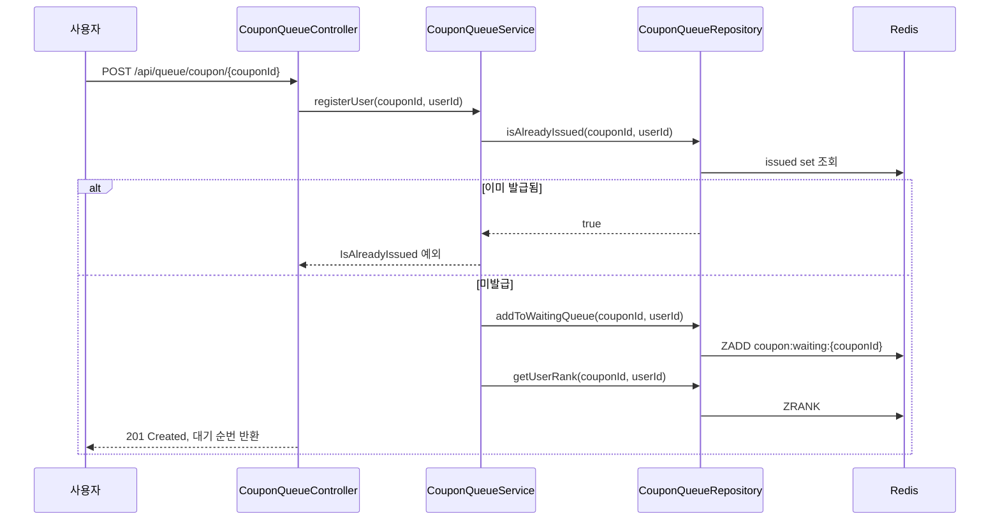
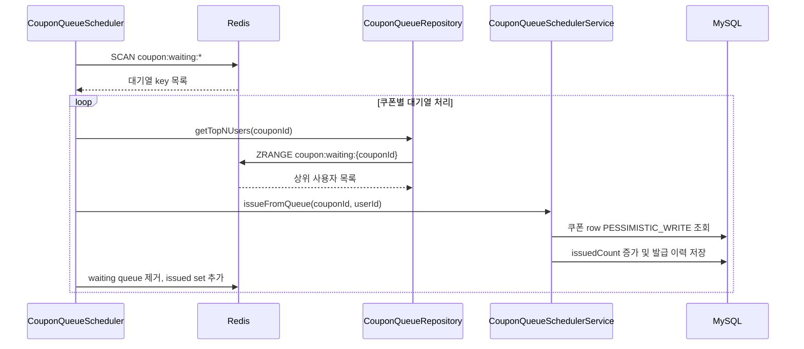

# CouponIssue : 대규모 트래픽 쿠폰 발급 개선 프로젝트

대규모 트래픽 환경에서 선착순 쿠폰 발급 API가 어떤 병목과 정합성 문제를 겪는지 재현하고, 발급 구조를 개선했을 때 처리량, 응답 시간, 초과 발급 방지 측면에서 얼마나 개선되는지 확인하기 위한 Spring Boot 프로젝트입니다.

단순한 쿠폰 CRUD가 아니라, 한정 수량 쿠폰에 많은 사용자가 동시에 접근하는 상황을 기준선으로 삼고 DB lock, Redis 대기열, 스케줄러 기반 비동기 처리 전략을 비교하는 것이 핵심입니다.

## 프로젝트 목표

- 동시에 많은 사용자가 쿠폰 발급을 요청하는 상황을 재현한다.
- 기준선 구현에서 발생하는 동시성 문제와 DB 병목을 확인한다.
- 발급 구조를 단계적으로 개선한다.
- 개선 전후의 성능과 정합성 지표를 같은 조건에서 비교한다.

주요 비교 대상:

- 처리량: 초당 처리 가능한 발급 요청 수
- 응답 시간: 평균, p95, p99 latency
- 정합성: 초과 발급 여부, 중복 발급 여부, 최종 발급 수
- 안정성: 실패율, DB lock wait, deadlock, timeout
- 리소스 사용량: DB connection, CPU, memory, Redis command 처리량

## 핵심 시나리오

한정 수량 쿠폰을 대상으로 다수의 회원이 동시에 발급을 요청합니다.

예시:

- 쿠폰 수량: 100장
- 동시 요청 사용자: 1,000명
- 기대 결과: 성공 발급은 정확히 100건
- 실패 요청: 수량 소진 또는 중복 요청으로 일관되게 실패
- 검증 대상: 초과 발급 없이 응답 시간이 얼마나 낮은지

## 개선 흐름

### v0. JPA 조회 후 수량 증가

가장 단순한 기준선입니다.

```text
1. 인증된 회원 조회
2. 쿠폰 조회
3. issuedCount 증가
4. 발급 이력 저장
5. 트랜잭션 커밋
```

이 방식은 구현이 단순하지만, 대규모 동시 요청에서는 lost update, 초과 발급, DB row 경합 문제가 발생할 수 있습니다.

### v1. DB 비관적 락 기반 발급

현재 동기 발급 API는 쿠폰 row를 `PESSIMISTIC_WRITE`로 조회한 뒤 발급 수량을 증가시킵니다.

```java
@Lock(LockModeType.PESSIMISTIC_WRITE)
@Query("SELECT c FROM Coupon c WHERE c.couponId = :couponId")
Optional<Coupon> findByCouponIdForUpdate(@Param("couponId") Long couponId);
```

기대 효과:

- 같은 쿠폰 row에 대한 동시 갱신을 직렬화한다.
- `issuedCount >= totalCount` 검사를 통해 초과 발급을 막는다.
- 구현 복잡도는 낮지만, 트래픽이 몰리면 DB lock wait가 증가할 수 있다.

### v2. Redis 대기열 기반 선착순 처리

현재 구현된 개선 구조입니다. API 요청은 Redis Sorted Set에 사용자를 등록하고, 스케줄러가 주기적으로 대기열 상위 사용자를 꺼내 DB 발급을 수행합니다.

```text
1. 사용자가 쿠폰 발급 요청
2. Redis ZSet 대기열에 userId 등록
3. 현재 대기 순번 반환
4. Scheduler가 500ms마다 쿠폰별 대기열 조회
5. 상위 N명씩 DB 발급 처리
6. 성공 사용자는 issued set에 기록
7. 실패 사용자는 failed queue로 이동 후 재처리
```

기대 효과:

- 순간 트래픽을 Redis 대기열로 먼저 흡수한다.
- API 요청과 실제 DB 쓰기 부하를 분리한다.
- DB에는 스케줄러가 제한된 batch 단위로 접근한다.
- 사용자에게는 빠르게 대기 순번을 반환할 수 있다.

## 아키텍처

### 대기열 등록



### 스케줄러 발급



## 측정 기준

개선 효과는 같은 조건에서 기준선과 개선안을 반복 측정해 비교합니다.

### 고정해야 할 조건

- 쿠폰 총 수량
- 동시 사용자 수
- 총 요청 수
- 애플리케이션 인스턴스 수
- DB connection pool 크기
- Redis, DB 스펙과 초기 데이터
- JVM 옵션
- 테스트 도구와 시나리오

### 기록할 지표

| 지표 | 의미 |
| --- | --- |
| Total Requests | 전체 발급 요청 수 |
| Success Count | 실제 발급 성공 수 |
| Fail Count | 발급 실패 수 |
| Over-issued Count | 쿠폰 총 수량을 초과한 발급 수 |
| Duplicate Count | 동일 회원 중복 발급 수 |
| TPS/RPS | 초당 처리량 |
| Avg Latency | 평균 응답 시간 |
| p95 Latency | 상위 5% 요청의 응답 시간 |
| p99 Latency | 상위 1% 요청의 응답 시간 |
| Error Rate | 전체 요청 중 오류 비율 |
| DB Lock Wait | DB row 경합 정도 |
| Queue Size | Redis 대기열 적체량 |

### 개선 폭 계산

```text
처리량 개선 배율 = 개선 후 TPS / 기준선 TPS
응답 시간 개선율 = (기준선 latency - 개선 후 latency) / 기준선 latency * 100
정합성 개선 = 초과 발급 수, 중복 발급 수가 0인지 확인
```

## 측정 결과 기록

실제 부하 테스트 결과는 같은 조건에서 반복 측정한 뒤 아래 표에 기록합니다.

| 버전 | 전략 | 동시 사용자 | 쿠폰 수량 | TPS/RPS | Avg | p95 | p99 | 성공 | 실패 | 초과 발급 | 중복 발급 | 비고 |
| --- | --- | ---: | ---: | ---: | ---: | ---: | ---: | ---: | ---: | ---: | ---: | --- |
| v0 | JPA 조회 후 수량 증가 | - | - | - | - | - | - | - | - | - | - | 기준선 |
| v1 | DB 비관적 락 | - | - | - | - | - | - | - | - | - | - | 구현 |
| v2 | Redis 대기열 + Scheduler | - | - | - | - | - | - | - | - | - | - | 구현 |

## 현재 구현 기능

- 회원 가입
  - 이메일 중복 검증
  - BCrypt 비밀번호 암호화
  - 기본 권한 `MEMBER` 부여
- 로그인
  - Spring Security 인증
  - JWT access token 발급
  - 토큰 만료 기간 7일
- 쿠폰 관리
  - 쿠폰 생성
  - 쿠폰 단건 조회
- 동기 쿠폰 발급
  - 인증된 회원에게 쿠폰 발급
  - DB 비관적 락으로 쿠폰 수량 보호
  - 발급 이력 저장
- 대기열 기반 쿠폰 발급
  - Redis ZSet 대기열 등록
  - 대기 순번 반환
  - 발급 완료 여부 조회
  - Scheduler 기반 batch 발급
  - 실패 queue 재처리

## API

### 회원 가입

```http
POST /members/signup
Content-Type: application/json
```

```json
{
  "email": "user@example.com",
  "password": "password123!",
  "name": "홍길동"
}
```

### 로그인

```http
POST /members/login
Content-Type: application/json
```

```json
{
  "email": "user@example.com",
  "password": "password123!"
}
```

응답의 `accessToken` 값을 이후 인증 API 호출에 사용합니다.

```http
Authorization: Bearer {accessToken}
```

### 쿠폰 생성

```http
POST /coupons
Authorization: Bearer {accessToken}
Content-Type: application/json
```

```json
{
  "name": "선착순 쿠폰",
  "totalCount": 100
}
```

### 쿠폰 조회

```http
GET /coupons/{couponId}
Authorization: Bearer {accessToken}
```

### 동기 쿠폰 발급

```http
POST /coupons/issue/{couponId}
Authorization: Bearer {accessToken}
Content-Type: application/json
```

```json
{}
```

### 대기열 등록

```http
POST /api/queue/coupon/{couponId}
Authorization: Bearer {accessToken}
```

응답 예시:

```json
{
  "success": true,
  "response": "쿠폰 발급 요청 완료. 현재 대기 순번: 1"
}
```

### 발급 상태 조회

```http
GET /api/queue/coupon/{couponId}/status
Authorization: Bearer {accessToken}
```

## 기술 스택

- Java 17
- Spring Boot 3.4.1
- Spring Web
- Spring Data JPA
- Spring Security
- Spring Data Redis
- MySQL Connector/J
- Redis
- JWT (`com.auth0:java-jwt`)
- Thymeleaf
- Lombok
- JUnit 5
- Awaitility

## 프로젝트 구조

```text
src/main/java/couponToy/CouponToyProject
├── Coupon
├── CouponIssue
├── Member
├── global
│   ├── aop
│   ├── api
│   ├── config
│   ├── constant
│   ├── entity
│   ├── exception
│   └── security
└── queue
    ├── controller
    ├── repository
    ├── scheduler
    ├── service
    └── util
```

## 실행 준비

저장소에는 DB와 Redis 접속 설정 파일이 포함되어 있지 않습니다. 로컬 실행 전 `src/main/resources/application.yml` 또는 `application.properties`를 추가해야 합니다.

예시:

```yaml
spring:
  datasource:
    url: jdbc:mysql://localhost:3306/coupon_toy
    username: root
    password: password
    driver-class-name: com.mysql.cj.jdbc.Driver

  data:
    redis:
      host: localhost
      port: 6379

  jpa:
    hibernate:
      ddl-auto: update
    properties:
      hibernate:
        format_sql: true
    open-in-view: false
```

## 실행 방법

```bash
./gradlew bootRun
```

테스트 실행:

```bash
./gradlew test
```

## 테스트

현재 테스트는 회원 저장, 쿠폰 발급, 순차 발급, 동시 발급, Redis 대기열 발급 시나리오를 포함합니다.

- `MemberServiceTest`
- `IssueCouponServiceTest`
- `CouponQueueServiceTest`

대규모 트래픽 개선 폭은 JMeter, k6, Gatling 같은 부하 테스트 도구를 추가해 같은 조건에서 반복 측정하는 방식으로 확인하는 것이 적합합니다.

## 현재 구현 메모

- JWT secret key는 코드에 고정되어 있어 운영 환경에서는 외부 설정으로 분리해야 합니다.
- Redis 대기열은 API 응답 latency를 낮추는 대신 최종 발급 완료까지 비동기 지연이 발생할 수 있습니다.
- 현재 스케줄러는 500ms마다 쿠폰별 상위 5명을 처리합니다. 처리 batch 크기와 주기는 부하 테스트 결과에 맞춰 조정해야 합니다.
- 중복 발급 방지는 Redis issued set을 사용하지만, 운영 수준에서는 DB unique constraint도 함께 두는 것이 안전합니다.
